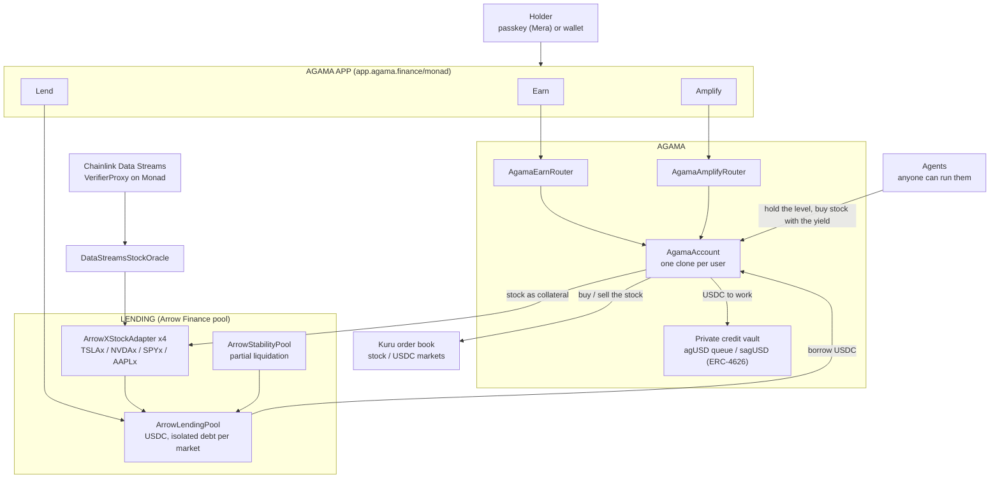

# Agama on Monad: deposit your stock, get more stock

**[Try the app](https://app.agama.finance/monad)** · Monad testnet (chain 10143) · Metropolis, track Onchain Finance & Trading

xStocks just brought 1,100 tokenized US equities natively to Monad, and Aave is
proposing a V4 hub that lends USDC against them. What a holder does with that
loan is still left to them. Agama does it: deposit a tokenized stock, the
protocol borrows USDC against it at a safe level, puts the USDC to work in a
private credit vault, and permissionless agents keep the level and turn the
yield back into **more of the same stock**. What grows is your share count.

- **Earn.** One deposit, nothing to set. The stock rises, the agents borrow the
  difference; it falls, they repay from the yield already earned, never by
  selling your stock.
- **Amplify.** Borrow against the stock, buy more of it, deposit that too. The
  level reached becomes the target the agents hold.
- **Lend.** Supply USDC to the pool the positions borrow from.

## Prices: Chainlink Data Streams, verified on chain

Every price is a signed Chainlink Data Streams report (RWA Advanced, schema
v11), checked on chain by Chainlink's own VerifierProxy before the oracle
stores it. Anyone can bring a report: the keeper does, an agent or a user can.
Nobody can choose the price.

```
Chainlink Data Engine ──signed reports──▶ keeper (or anyone)
                                              │ pushReports(bytes[])
                                              ▼
                     DataStreamsStockOracle ──verify()──▶ Chainlink VerifierProxy
                       │  right stream for this stock?      (DON signatures)
                       │  stream inside its own session?
                       │  observed under 5 minutes ago? newer than the last?
                       ▼
                     collateral adapters (LTV, threshold; tighter when the market is shut)
```

Chainlink publishes one stream per session (regular, extended, overnight). The
oracle believes each only for its own: while the regular session trades, the
overnight stream still publishes, at a different price (TSLA 383.77 against
379.59 in our fixtures), and the oracle refuses it. Out of session the last
close holds and the terms tighten on both sides.

Checked against the real thing: `test/DataStreamsFork.t.sol` runs real signed
reports through Chainlink's VerifierProxy on a fork of Monad testnet. A genuine
report is stored; one bit changed is refused by Chainlink (`BadVerification`);
the overnight stream in the regular session is refused; a report over five
minutes old is refused.

## Trading: Kuru's order book

Every buy and sell of stock goes through Kuru, Monad's on-chain order book.
Agama listed the four stocks against USDC (`script/KuruMarkets.s.sol`) and
routes through `KuruVenue`: the lending pool takes the ERC-4626 wrapper, the
book trades the base xStock, the venue sits between them. Amplify's loop, Buy
and Earn and the agents' compounding all fill on the book, and every fill is
still held against the Chainlink price by the account that asked for it.
Testnet has nobody else trading these stocks, so a small market maker
(`scripts/kuru_mm.py`) quotes four levels a side around the oracle price.

| Book | Address |
|---|---|
| TSLAx / USDC | [`0x24AdBF55f7794b42Bb0cBB42Ec97Db432E4F7bCC`](https://testnet.monadvision.com/address/0x24AdBF55f7794b42Bb0cBB42Ec97Db432E4F7bCC) |
| NVDAx / USDC | [`0xF9cda4A47cabA75b065A6AE56BaefE6C19934aEf`](https://testnet.monadvision.com/address/0xF9cda4A47cabA75b065A6AE56BaefE6C19934aEf) |
| SPYx / USDC | [`0x01a1843f5a5b2964aaF9Ac7bC95A1C2527F0cD98`](https://testnet.monadvision.com/address/0x01a1843f5a5b2964aaF9Ac7bC95A1C2527F0cD98) |
| AAPLx / USDC | [`0x3d06BD639f8b283B1635Eb543B86701cB93F2B91`](https://testnet.monadvision.com/address/0x3d06BD639f8b283B1635Eb543B86701cB93F2B91) |
| KuruVenue | [`0x61deAb234B260b7e2E6c143A3847A6978eCfD4FC`](https://testnet.monadvision.com/address/0x61deAb234B260b7e2E6c143A3847A6978eCfD4FC) |

`test/KuruVenue.t.sol` creates a market through Kuru's own Router on a fork of
Monad testnet and runs a whole Amplify open and close through it.

## Automation: a Chainlink CRE workflow

`cre/agama-monad` is the protocol's keeper as a CRE workflow. Every minute the
DON fetches the signed Data Streams reports, reads the oracle and every
position on Monad, and writes one report through the Keystone Forwarder to
[`AgamaCREReceiver`](https://testnet.monadvision.com/address/0xec27460813bEB044DB01A1C1F28b91E69d8c95b8),
which has the oracle verify each price with Chainlink's VerifierProxy and runs
the permissionless rebalance on positions off target. DON consensus on top of
DON signatures; the receiver holds no role. Simulated with `--broadcast` on
Monad testnet: [`0xfc11945c…2858`](https://testnet.monadvision.com/tx/0xfc11945c3afa72ab7298f08314934570bd1a98fd5c4a0a53b294518b59bc2858)
carried four prices through the forwarder, the verifier and into the oracle.
Details in [`cre/README.md`](cre/README.md).

## Architecture



## Where it lives

| | |
|---|---|
| App | https://app.agama.finance/monad |
| Test funds | Faucet tab: 10,000 USDC and 10 of each stock in one transaction. MON for gas at https://faucet.monad.xyz |
| Contracts | every address in [`deployments/10143.json`](deployments/10143.json) |
| Oracle | [`0xCd4186dF8b4A93A693Db4f9E6A80Ce7478131BC8`](https://testnet.monadvision.com/address/0xCd4186dF8b4A93A693Db4f9E6A80Ce7478131BC8) |
| Lending pool | [`0x5d40EbE874DDA0cc78CC134e5378e013B65d2D7b`](https://testnet.monadvision.com/address/0x5d40EbE874DDA0cc78CC134e5378e013B65d2D7b) |
| Earn router | [`0xac8bC881d09fC5E405E5b56D1E2AE04dcad200C8`](https://testnet.monadvision.com/address/0xac8bC881d09fC5E405E5b56D1E2AE04dcad200C8) |
| Chainlink VerifierProxy | [`0x72790f9eB82db492a7DDb6d2af22A270Dcc3Db64`](https://testnet.monadvision.com/address/0x72790f9eB82db492a7DDb6d2af22A270Dcc3Db64) |

Testnet has no xStocks and no Circle USDC the protocol can mint for a demo, so
the deployment runs on stand-ins (`src/mocks/TestnetTokens.sol`) priced by the
real Chainlink streams.

## Run it

```bash
forge test                          # 86 tests, offline
MONAD_FORK=1 forge test             # 95: plus real Chainlink reports and real Kuru markets on a Monad testnet fork
./scripts/prepush.sh                # what CI runs, on a clean clone of HEAD
anvil --fork-url https://testnet-rpc.monad.xyz &
python3 scripts/e2e.py fork         # 18 steps, 41 checks on a fork of the live deployment
python3 scripts/keeper.py           # prices, protection, agents (KEEPER_KEY, Data Streams credentials)
cd web && pnpm dev                  # http://localhost:3004/monad
```

The keeper runs on GitHub Actions (`.github/workflows/keeper.yml`), with a key
that holds no role in the protocol: verified prices when they move, the Kuru
quotes, the agents.

## Built during Metropolis, and before it

Agama shipped the same Earn / Amplify design on X Layer for OKX Dev Day
(September 2026, [agamafinance/agama-xlayer](https://github.com/agamafinance/agama-xlayer)),
on an Arrow Finance lending pool ported by Agama under the Arrow x Agama
partnership. This repository starts from that code (first commit). Built for
Metropolis:

- the price layer for Monad: Chainlink Data Streams as the only source, one
  stream per session, five-minute reports, verified by Chainlink's VerifierProxy
  on Monad, with fork tests on real signed reports;
- Kuru as the venue for every stock buy and sell: the four markets, the venue,
  the market maker;
- the Chainlink CRE workflow and its receiver;
- passkey sign-in with Mera, a one-transaction faucet, the Monad front;
- the Monad deployment, the keeper, the end-to-end run on a fork of it.

## Known limits

- Testnet stand-ins for the stocks and USDC; the prices are real.
- The admin key can still write a price (`push`, bounded by a deviation cap)
  for emergencies; the keeper never uses it.
- Out of session the price is the last close, with tighter terms.
