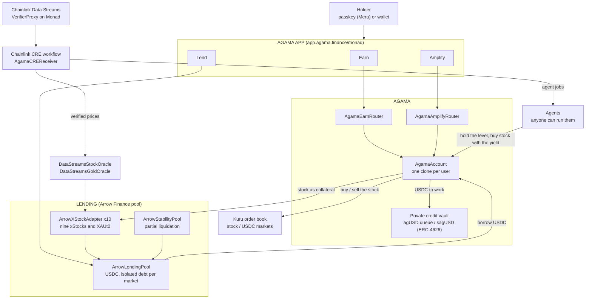

# Agama on Monad: deposit your stock, get more stock

**[Try the app](https://app.agama.finance/monad)** · Monad testnet (chain 10143) · Metropolis, track Onchain Finance & Trading

xStocks just brought 1,100 tokenized US equities natively to Monad, and a
holder can only hold them. Agama turns them into a position that grows: deposit
the stock into an Arrow lending market, the protocol borrows USDC against it at
a safe level, puts the USDC to work in the Agama private credit vault, and
permissionless agents keep the level and turn the yield back into **more of the
same stock**. What grows is your share count, not a stablecoin balance.

- **Earn.** One deposit and the level the agents hold. The stock rises, they borrow the
  difference; it falls, they repay from the yield already earned, never by
  selling your stock.
- **Amplify.** Borrow against the stock, buy more of it, deposit that too. The
  level reached becomes the target the agents hold.
- **Lend.** Supply USDC to the pool the positions borrow from.

## Prices: Chainlink Data Streams, verified on chain

Every price is a signed Chainlink Data Streams report (RWA Advanced, schema
v11), checked on chain by Chainlink's own VerifierProxy before the oracle
stores it. Anyone can bring a report: the keeper does, an agent or a user can.
Nobody can choose the price.

```
Chainlink Data Engine ──signed reports──▶ keeper (or anyone)
                                              │ pushReports(bytes[])
                                              ▼
                     DataStreamsStockOracle ──verify()──▶ Chainlink VerifierProxy
                       │  right stream for this stock?      (DON signatures)
                       │  stream inside its own session?
                       │  observed under 5 minutes ago? newer than the last?
                       ▼
                     collateral adapters (LTV, threshold; tighter when the market is shut)
```

Gold has its own oracle,
[`DataStreamsGoldOracle`](https://testnet.monadvision.com/address/0x5C2C5F19A17B62055221bD8b80783E86b802e9Eb): Chainlink
carries XAU/USD in its crypto schema (v3), with no market session, and one
XAUt0 is one troy ounce. Same rules: verified by the VerifierProxy, under five
minutes old, newer than the last.

Chainlink publishes one stream per session (regular, extended, overnight). The
oracle believes each only for its own: while the regular session trades, the
overnight stream still publishes, at a different price (TSLA 383.77 against
379.59 in our fixtures), and the oracle refuses it. Out of session the last
close holds and the terms tighten on both sides.

Checked against the real thing: `test/DataStreamsFork.t.sol` runs real signed
reports through Chainlink's VerifierProxy on a fork of Monad testnet. A genuine
report is stored; one bit changed is refused by Chainlink (`BadVerification`);
the overnight stream in the regular session is refused; a report over five
minutes old is refused.

## Trading: Kuru's order book

Every buy and sell of stock goes through Kuru, Monad's on-chain order book.
Agama listed the nine stocks and gold against USDC (`script/KuruMarkets.s.sol`,
`script/AddMarkets.s.sol`, `script/AddGold.s.sol`) and
routes through `KuruVenue`: the lending pool takes the ERC-4626 wrapper, the
book trades the base xStock, the venue sits between them. Amplify's loop, Buy
and Earn and the agents' compounding all fill on the book, and every fill is
still held against the Chainlink price by the account that asked for it.
Testnet has nobody else trading these stocks, so a small market maker
(`scripts/kuru_mm.py`) quotes four levels a side around the oracle price.

| Book | Address |
|---|---|
| TSLAx / USDC | [`0x24AdBF55f7794b42Bb0cBB42Ec97Db432E4F7bCC`](https://testnet.monadvision.com/address/0x24AdBF55f7794b42Bb0cBB42Ec97Db432E4F7bCC) |
| NVDAx / USDC | [`0xF9cda4A47cabA75b065A6AE56BaefE6C19934aEf`](https://testnet.monadvision.com/address/0xF9cda4A47cabA75b065A6AE56BaefE6C19934aEf) |
| SPYx / USDC | [`0x01a1843f5a5b2964aaF9Ac7bC95A1C2527F0cD98`](https://testnet.monadvision.com/address/0x01a1843f5a5b2964aaF9Ac7bC95A1C2527F0cD98) |
| AAPLx / USDC | [`0x3d06BD639f8b283B1635Eb543B86701cB93F2B91`](https://testnet.monadvision.com/address/0x3d06BD639f8b283B1635Eb543B86701cB93F2B91) |
| QQQx / USDC | [`0x26EC7Ed35af8c914E077af28dAF3f9f06107E3e0`](https://testnet.monadvision.com/address/0x26EC7Ed35af8c914E077af28dAF3f9f06107E3e0) |
| GOOGLx / USDC | [`0x2C6e24245D79bE1ef124a665Ce714cE035Eea5cA`](https://testnet.monadvision.com/address/0x2C6e24245D79bE1ef124a665Ce714cE035Eea5cA) |
| MSFTx / USDC | [`0x0f3B0b1011d102B3a7eD6768fBcCebDa03825C03`](https://testnet.monadvision.com/address/0x0f3B0b1011d102B3a7eD6768fBcCebDa03825C03) |
| AMZNx / USDC | [`0x1C439824BDf900bf900E3698a059fEF9B6e5F9dD`](https://testnet.monadvision.com/address/0x1C439824BDf900bf900E3698a059fEF9B6e5F9dD) |
| METAx / USDC | [`0x66ff897EbA98e104C18677DF6802806e36EF9cfA`](https://testnet.monadvision.com/address/0x66ff897EbA98e104C18677DF6802806e36EF9cfA) |
| XAUt0 / USDC | [`0x6BFa7BcD643C60530F22c7B976485e28B77CB7aE`](https://testnet.monadvision.com/address/0x6BFa7BcD643C60530F22c7B976485e28B77CB7aE) |
| KuruVenue | [`0x61deAb234B260b7e2E6c143A3847A6978eCfD4FC`](https://testnet.monadvision.com/address/0x61deAb234B260b7e2E6c143A3847A6978eCfD4FC) |

`test/KuruVenue.t.sol` creates a market through Kuru's own Router on a fork of
Monad testnet and runs a whole Amplify open and close through it. On testnet
itself, `scripts/live_check.py` runs the user path with a fresh wallet: a gold
Amplify borrowed 10,495 USDC and bought XAUt0 on the book
([`0x5290ed24…69deb`](https://testnet.monadvision.com/tx/0x5290ed2482a5e91d36adf6831d4bcacf20ed811d63351bc98b416904acab6deb)),
then sold it back to close
([`0x7ededb6f…9cd20`](https://testnet.monadvision.com/tx/0x7ededb6f5ec234a749c425fb30828dafbd90dd70a3d6920f4e930e010ce9cd20)).

## Automation: the whole keeper is a Chainlink CRE workflow

Everything Agama does on its own runs through `cre/agama-monad`, every minute:

1. one chain read of [`AgamaKeeperLens`](https://testnet.monadvision.com/address/0xF8D5361FbcBAfaa03281Ec925d385eE7476Ad9B4):
   what the stock and gold oracles hold, and the jobs due on every position
   (liquidate, soft-deleverage, rebalance to the owner's LTV, compound the
   yield into more stock on Kuru, the vault's daily snapshot);
2. the signed Chainlink Data Streams reports of the nine stocks and gold,
   fetched by each node and agreed on by the DON, kept only when the price
   moved 0.5%, the session changed or the stored one is 50 minutes old;
3. each job estimated from the receiver, so one that would revert never costs
   gas;
4. one report through the Keystone Forwarder to
   [`AgamaCREReceiver`](https://testnet.monadvision.com/address/0x72f80190452B8a5fE19e639cEBAc476bD28D9E14),
   which hands the prices to the oracles (Chainlink's VerifierProxy verifies
   each on chain) and runs the jobs. DON consensus on top of DON signatures;
   the receiver holds no role and no funds.

The keeper on GitHub Actions runs it with `cre workflow simulate --broadcast`,
so every price and every agent action on the live deployment arrives through
the forwarder and the receiver. CRE_PROOF
Details in [`cre/README.md`](cre/README.md).

## Architecture



## Where it lives

| | |
|---|---|
| App | https://app.agama.finance/monad |
| Test funds | Faucet tab: 10,000 USDC and 10 of each of the ten assets in one transaction. MON for gas at https://faucet.monad.xyz |
| Contracts | every address in [`deployments/10143.json`](deployments/10143.json) |
| Oracle | [`0xCd4186dF8b4A93A693Db4f9E6A80Ce7478131BC8`](https://testnet.monadvision.com/address/0xCd4186dF8b4A93A693Db4f9E6A80Ce7478131BC8) |
| Lending pool | [`0x5d40EbE874DDA0cc78CC134e5378e013B65d2D7b`](https://testnet.monadvision.com/address/0x5d40EbE874DDA0cc78CC134e5378e013B65d2D7b) |
| Earn router | [`0xac8bC881d09fC5E405E5b56D1E2AE04dcad200C8`](https://testnet.monadvision.com/address/0xac8bC881d09fC5E405E5b56D1E2AE04dcad200C8) |
| Chainlink VerifierProxy | [`0x72790f9eB82db492a7DDb6d2af22A270Dcc3Db64`](https://testnet.monadvision.com/address/0x72790f9eB82db492a7DDb6d2af22A270Dcc3Db64) |

Testnet has no xStocks and no Circle USDC the protocol can mint for a demo, so
the deployment runs on stand-ins (`src/mocks/TestnetTokens.sol`) priced by the
real Chainlink streams.

## Run it

```bash
forge test                          # 90 tests, offline
MONAD_FORK=1 forge test             # 105: plus real Chainlink reports (stocks and gold) and real Kuru markets on a Monad testnet fork
./scripts/prepush.sh                # what CI runs, on a clean clone of HEAD
anvil --fork-url https://testnet-rpc.monad.xyz &
python3 scripts/e2e.py fork         # 18 steps, 41 checks on a fork of the live deployment
python3 scripts/live_check.py       # the user path on Monad testnet itself: fresh wallet, real transactions (BUY=, AMP= pick the stocks)
python3 scripts/keeper.py           # the CRE workflow every minute, then the Kuru quotes (KEEPER_KEY, Data Streams credentials, CRE login)
cd web && pnpm dev                  # http://localhost:3004/monad
```

The keeper runs on GitHub Actions (`.github/workflows/keeper.yml`), with a key
that holds no role in the protocol: the CRE workflow (verified prices when they
move, the agents), then the Kuru quotes. A tick where the CRE run fails does the
same jobs from Python.

## Built during Metropolis, and before it

Agama shipped the same Earn / Amplify design on X Layer for OKX Dev Day
(September 2026, [agamafinance/agama-xlayer](https://github.com/agamafinance/agama-xlayer)),
on an Arrow Finance lending pool ported by Agama under the Arrow x Agama
partnership. This repository starts from that code (first commit). Built for
Metropolis:

- the price layer for Monad: Chainlink Data Streams as the only source, one
  stream per session, five-minute reports, verified by Chainlink's VerifierProxy
  on Monad, with fork tests on real signed reports;
- ten markets: nine xStocks and Tether Gold, its oracle on the XAU/USD stream;
- Kuru as the venue for every stock buy and sell: the ten books, the venue,
  the market maker;
- the Chainlink CRE workflow as the protocol's keeper: prices for the ten
  markets, liquidations, soft deleverage, rebalancing, compounding through
  Kuru, its receiver and its lens;
- passkey sign-in with Mera, a one-transaction faucet, the Monad front;
- the Monad deployment, the keeper, the end-to-end run on a fork of it.

## Known limits

- Testnet stand-ins for the stocks and USDC; the prices are real.
- The admin key can still write a price (`push`, bounded by a deviation cap)
  for emergencies; the keeper never uses it.
- Out of session the price is the last close, with tighter terms.
